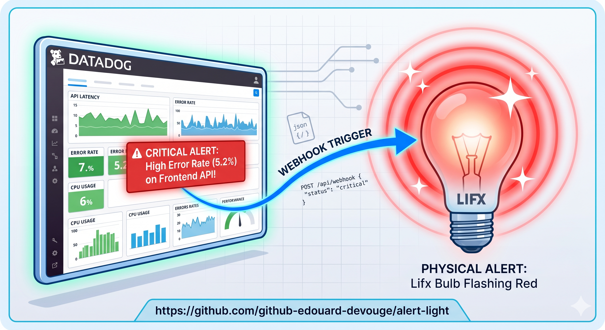

# alert-light

A tiny **Python Cloudflare Worker** that lights up a physical **LIFX** bulb
whenever a **Datadog** monitor triggers.



```
Datadog monitor
   │  POST webhook + X-Webhook-Token
   ▼
Cloudflare Python Worker ──► LIFX HTTP API ──► your bulb
```

The Worker is stateless: ~150 lines of Python running on Cloudflare's edge,
free tier, no servers to maintain.

---

## Project layout

```
.
├── Makefile               # dev + deploy targets (uv + pywrangler)
├── wrangler.jsonc         # Worker config (entry point, compat flags, vars)
├── package.json           # pulls in `wrangler` (Node CLI underneath pywrangler)
├── pyproject.toml         # dev deps (workers-py, pytest, ruff)
├── .dev.vars.example      # template for local secrets (real .dev.vars is gitignored)
├── spec/                  # design doc (source of truth for behavior)
├── src/
│   ├── entry.py           # WorkerEntrypoint — routes + auth
│   ├── profiles.py        # alert_type -> visual effect mapping (pure)
│   └── lifx_client.py     # outbound fetch to the LIFX HTTP API
└── tests/
    ├── test_profiles.py            # pure-Python unit tests
    └── test_worker_integration.py  # opt-in: spawns `pywrangler dev`
```

---

## Quick start (local)

Prerequisites:

- [`uv`](https://docs.astral.sh/uv/) for the Python toolchain
- **Node.js 22 LTS** specifically — pywrangler still passes
  `--experimental-wasm-stack-switching`, a flag removed in Node 24+. The
  Makefile auto-detects `node@22` from Homebrew without touching your
  global `node` symlink:
  ```bash
  brew install node@22
  ```

Then:

```bash
make install                        # uv sync + npm install wrangler
cp .dev.vars.example .dev.vars      # fill LIFX_TOKEN and SHARED_SECRET
make test                           # run the pure-Python suite
make dev                            # boots the Worker on http://localhost:8787
```

Smoke test:

```bash
TOKEN=$(grep ^SHARED_SECRET .dev.vars | cut -d= -f2)
curl -X POST http://localhost:8787/webhook \
  -H 'Content-Type: application/json' \
  -H "X-Webhook-Token: $TOKEN" \
  -d '{"alert_type":"error","transition":"Triggered","monitor_id":1,"title":"smoke test"}'
```

---

## Deploy to Cloudflare

You need a Cloudflare account (free tier is enough).

```bash
make cf-login          # OAuth in your browser
make secrets           # interactive prompts for LIFX_TOKEN and SHARED_SECRET
make deploy            # publishes the Worker
make tail              # stream live logs
```

After deploy, configure the Datadog webhook
(*Integrations → Webhooks*):

| Field          | Value                                                          |
|----------------|----------------------------------------------------------------|
| Name           | `webhook-lifx-alert`                                           |
| URL            | `https://alert-light.<account>.workers.dev/webhook`            |
| Custom header  | `X-Webhook-Token: <your SHARED_SECRET>`                        |
| Payload        | see `spec/design-doc.md` § 5.5                                 |

Reference the webhook from a monitor's notification message
(`@webhook-lifx-alert`) and scope it to monitors tagged
`alert_lamp:true` to avoid getting flashed by every alert in your account.

---

## Endpoints

| Method | Path       | Auth required? | Description                                       |
|--------|------------|----------------|---------------------------------------------------|
| GET    | `/health`  | no             | Returns `{"status": "ok"}`. Use for uptime.       |
| POST   | `/webhook` | yes, header    | Receives Datadog payload, triggers a LIFX effect. |

`/webhook` requires the `X-Webhook-Token` header to match `SHARED_SECRET`
(constant-time comparison). Anything else returns `401`. Unknown routes
return `404`.

---

## Alert → light mapping

| `alert_type` | Effect    | Color  | Approx. duration |
|--------------|-----------|--------|------------------|
| `error`      | `pulse`   | red    | ~7 s             |
| `warning`    | `pulse`   | orange | ~6 s             |
| `success`    | `breathe` | green  | ~4.5 s           |
| `info`       | `breathe` | blue   | ~4 s             |
| `no_data`    | `breathe` | purple | ~4.5 s           |

A Datadog `transition: Recovered` always plays the `success` profile,
regardless of the original `alert_type`. Unknown alert types are ignored
(HTTP `202`), not errored — Datadog should keep working.

---

## Testing

```bash
make test               # pure-Python unit tests (no Worker runtime)
make test-integration   # spawns `pywrangler dev` and hits a real local Worker
```

The default `make test` is fast and offline: it imports `src/profiles.py`
directly. The integration suite is opt-in because it needs the full
Pyodide-based Worker runtime to boot.

---

## Security

- **Secrets** (`LIFX_TOKEN`, `SHARED_SECRET`) never live in source. In
  production they are pushed via `pywrangler secret put` and stored
  encrypted by Cloudflare. Locally they live in `.dev.vars`, which is
  gitignored.
- `.gitignore` excludes `.dev.vars`, `.env`, `*.pem`, `*.key`,
  `credentials.json`, `.wrangler/`, `node_modules/` and the usual
  suspects. Only `.dev.vars.example` (a template with empty values) is
  tracked.
- The webhook endpoint authenticates each request with a constant-time
  comparison (`hmac.compare_digest`) on `X-Webhook-Token` — no timing
  side-channel.
- TLS is terminated by Cloudflare; the Worker→LIFX hop is also HTTPS.
- No PII flows through the payload — only `alert_type`, `transition`,
  `monitor_id`, and `title`. Treat `title` as low-sensitivity but not as
  a secret.
- Rotate `LIFX_TOKEN` and `SHARED_SECRET` from their respective
  dashboards if you suspect a leak. Updating the Worker secret is one
  command: `pywrangler secret put SHARED_SECRET`.

---

## Contributing

PRs welcome. The project is intentionally small — keep it that way.

### Workflow

1. Fork and create a feature branch:
   `git checkout -b feature/short-description`.
2. `make install && make test && make lint` must all succeed before you
   push.
3. Add tests for new behavior. Prefer extending `test_profiles.py` — pure
   Python tests stay fast and runnable everywhere. Only reach for the
   integration suite when you genuinely need to exercise the Worker
   runtime.
4. The webhook handler must stay stateless. If you need state
   (deduplication, rate-limiting), use Cloudflare KV — don't smuggle it
   into the handler.
5. Open a PR explaining the *why* of the change. Link to the relevant
   section of `spec/design-doc.md` if you're changing observable
   behavior.

### Code style

- Python ≥ 3.12 (Cloudflare's Python Worker runtime tracks recent
  CPython via Pyodide).
- `make lint` (ruff) must pass.
- Docstrings and comments in **English**.
- Default to no comments — only add one when the *why* is non-obvious.
- Keep modules under ~150 lines. If a module grows, that's usually a
  sign that a new responsibility deserves its own file.
- The Worker imports only the **stdlib** + the `workers` module exposed
  by the runtime. No third-party runtime dependencies — they don't all
  work under Pyodide.

### Things that are explicitly out of scope (v1)

See `spec/design-doc.md` § 3.2:
multi-user bulbs, audio alerts, PagerDuty integration, physical ack button,
synchronization across bulbs.

---

## License

MIT.
